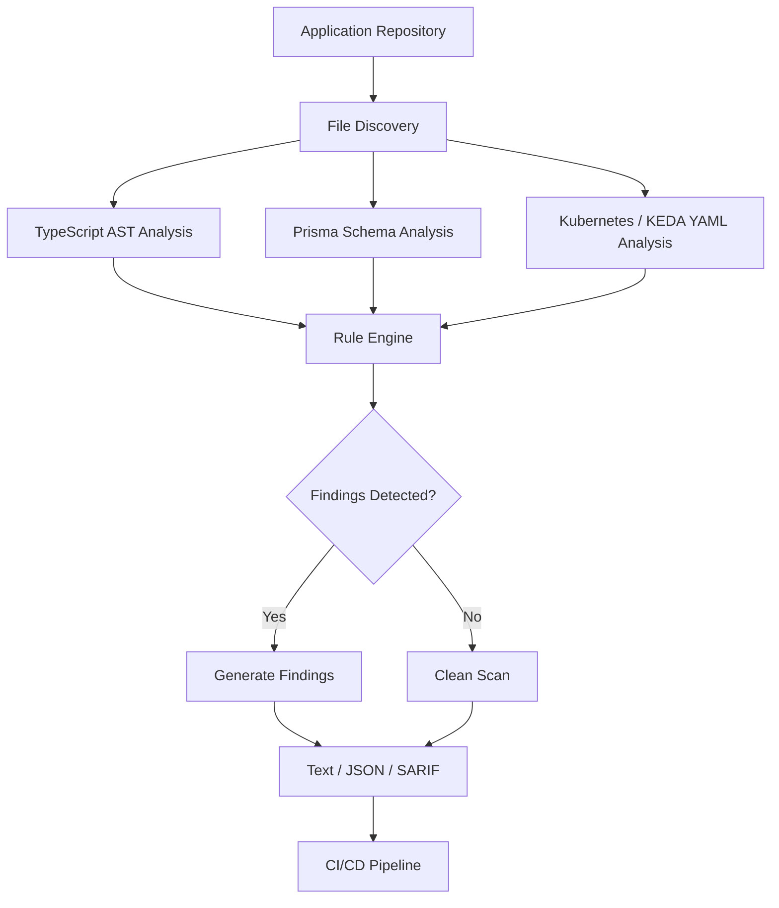

# 

<div align="center">

### Catch scalability bottlenecks before they reach production.

**A cloud-native static scalability scanner for modern CI/CD pipelines.**

ScaleLint analyzes application code, database schemas, and Kubernetes autoscaling configurations to identify potential performance bottlenecks before they become production incidents.

[](LICENSE)


[**Explore the Repository**](https://github.com/AyaanShaheer/scalelint) · [Report a Bug](https://github.com/AyaanShaheer/scalelint/issues) · [Contribute](https://github.com/AyaanShaheer/scalelint/pulls)

</div>

---

## 🚨 The Problem

Your application works perfectly with 1000 users.

But what happens when 100,000 users arrive overnight?

A single unbounded database query, an inefficient ORM call inside a loop, or an improperly configured Kubernetes autoscaler can turn a successful deployment into a production outage.

Traditional development tools solve different problems:

| Tool | What it detects |
|---|---|
| Trivy | Security vulnerabilities and CVEs |
| Gitleaks | Exposed secrets and credentials |
| SonarQube | Code quality and maintainability issues |
| **ScaleLint** | **Potential scalability bottlenecks and infrastructure capacity risks** |

Most teams test whether their application works. ScaleLint helps identify patterns that might prevent it from scaling.

## 💡 What is ScaleLint?

ScaleLint is a Rust-based static analysis tool designed to detect scalability anti-patterns across three important layers of a cloud-native application:

- **Application Layer:** Identifies potentially expensive database and network operations, unbounded Prisma queries, and process-local state.
- **Database Layer:** Examines Prisma schema indexes and cross-references them with application query patterns.
- **Infrastructure Layer:** Analyzes Kubernetes HPA and KEDA autoscaling configurations against configured database connection limits.

The goal is simple:

> **Catch scalability problems during code review, not during a production traffic spike.**

## 🔍 Detection Rules

ScaleLint currently implements five detection rules.

| Rule ID | Severity | Layer | Detection |
|---|---|---|---|
| `SCALE-001` | 🔴 CRITICAL | Application AST | **Repeated awaited I/O:** Detects database or network calls inside `for`, `while`, and other supported loops. |
| `SCALE-002` | 🟠 HIGH | Application AST | **Unbounded queries:** Detects Prisma `.findMany()` calls without a `take` limit. |
| `SCALE-003` | 🔴 CRITICAL | Application + DB | **Potential unindexed lookups:** Cross-references Prisma query filters with indexed fields in `schema.prisma`. |
| `SCALE-004` | 🟠 HIGH | Kubernetes / KEDA | **Connection storms:** Estimates database connection demand using maximum replicas and configured pool size. |
| `SCALE-005` | 🟠 HIGH | Application + Kubernetes | **Process-local state:** Detects module-level `Map` and `Set` instances that may cause inconsistent state across replicas. |

### Understanding the rules

**SCALE-001 — Repeated I/O inside loops**

Problem:

```typescript
for (const orderId of orderIds) {
  const order = await prisma.order.findUnique({
    where: { id: orderId }
  });
}
```

Why it matters:

Repeated sequential I/O can increase latency and database connection pressure as the workload grows.

Potential improvement: Use a bulk query, batching, or another appropriate data-access strategy.

**SCALE-002 — Unbounded database queries**

Problem:

```typescript
const users = await prisma.user.findMany();
```

Why it matters:

As the table grows, fetching every record can consume excessive application memory and database resources.

Potential improvement:

```typescript
const users = await prisma.user.findMany({
  take: 100,
  skip: 0
});
```

**SCALE-003 — Potential unindexed lookups**

Problem:

```typescript
const orders = await prisma.order.findMany({
  where: {
    customerEmail: "user@example.com"
  }
});
```

Suppose the corresponding Prisma model does not define an index on `customerEmail`.

Potential improvement:

```prisma
model Order {
  id            String @id
  customerEmail String

  @@index([customerEmail])
}
```

Why it matters:

Queries filtering on non-indexed columns may require expensive table scans as the dataset grows.

**SCALE-004 — Database connection storms**

Consider the following configuration:

```yaml
max_db_connections: 500
db_pool_size: 10
```

And a Kubernetes/KEDA autoscaling configuration:

```yaml
apiVersion: keda.sh/v1alpha1
kind: ScaledObject

spec:
  maxReplicaCount: 100
```

ScaleLint estimates:

```text
100 replicas × 10 connections per pod
= 1,000 potential database connections

Configured database limit: 500

Result: HIGH severity
```

Why it matters:

Your autoscaler may successfully create additional application pods while overwhelming the database connection limit.

**SCALE-005 — Stateful pod traps**

Problem:

```typescript
const sessionCache = new Map<string, string>();
```

Why it matters:

When Kubernetes runs multiple replicas, each pod maintains its own independent in-memory state. This can result in inconsistent application behavior.

Potential improvement: Use an appropriate shared storage or caching layer, such as Redis.

---

## ⚙️ How It Works

ScaleLint uses a multi-stage static analysis workflow.



### Analysis pipeline

1. **File discovery:** Identifies supported source files and infrastructure manifests.
2. **Schema analysis:** Extracts index information from Prisma models.
3. **AST analysis:** Uses Tree-sitter to inspect TypeScript syntax and identify potentially expensive patterns.
4. **Infrastructure analysis:** Parses Kubernetes and KEDA YAML manifests and checks autoscaling limits.
5. **Rule evaluation:** Applies the configured scalability rules.
6. **Reporting:** Produces human-readable, JSON, or SARIF output.

## 🚀 Getting Started

### Prerequisites

- Rust stable toolchain
- Cargo
- Git

### 1. Clone the repository

```bash
git clone https://github.com/AyaanShaheer/scalelint.git

cd scalelint
```

### 2. Build ScaleLint

```bash
cargo build --release
```

### 3. Run your first scan

Scan the project root:

```bash
./target/release/scalelint .
```

Or install the binary locally:

```bash
cargo install --path .
```

Then run:

```bash
scalelint .
```

### 4. Generate a report

Human-readable output:

```bash
scalelint . --format text
```

JSON output:

```bash
scalelint . --format json
```

SARIF 2.1.0 output:

```bash
scalelint . --format sarif > scalelint.sarif
```

### CLI Reference

```text
scalelint [PATH] [OPTIONS]

Arguments:
  [PATH]              Target directory or file (default: .)

Options:
  --format <FORMAT>   Output format: text, json, sarif
  --config <CONFIG>   Configuration file (default: scalelint.yaml)
  -h, --help          Print help
```

## 🔧 Configuration

ScaleLint supports project-level configuration through `scalelint.yaml`.

Create a configuration file in your project root:

```yaml
# Database capacity configuration
max_db_connections: 500

# Maximum database connections allocated per application pod
db_pool_size: 10

# Rules to disable
disabled_rules: []
```

### Configuration options

| Parameter | Description | Default |
|---|---|---|
| `max_db_connections` | Maximum available database connections | `500` |
| `db_pool_size` | Configured database connection pool size per pod | `10` |
| `disabled_rules` | List of rule IDs to disable | `[]` |

Example: Disable the process-local state rule.

```yaml
disabled_rules:
  - SCALE-005
```

## 🛠️ Handling False Positives

Not every pattern detected by a static analyzer is necessarily a production problem.

ScaleLint supports inline rule suppression.

Suppress a specific rule:

```typescript
// scalelint-ignore SCALE-005
const localCache = new Map<string, string>();
```

Suppress all rules on a line:

```typescript
// scalelint-ignore
const localCache = new Map<string, string>();
```

The suppression comment can appear on the affected line or immediately above it.

Use suppressions carefully and document why the pattern is intentional.

## 🤖 GitHub Actions Integration

Bring scalability checks directly into your CI/CD pipeline.

ScaleLint includes a reusable GitHub Action.

### Example workflow

Create:

`.github/workflows/scalelint.yml`

```yaml
name: ScaleLint

on:
  push:
    branches: [main]
  pull_request:
    branches: [main]

permissions:
  contents: read
  security-events: write

jobs:
  scalability-scan:
    name: Scalability Analysis
    runs-on: ubuntu-latest

    steps:
      - name: Checkout Repository
        uses: actions/checkout@v4

      - name: Run ScaleLint
        uses: AyaanShaheer/scalelint@main
        with:
          path: "."
          format: "sarif"
          sarif-file: "scalelint.sarif"

      - name: Upload SARIF to GitHub Code Scanning
        if: always()
        uses: github/codeql-action/upload-sarif@v3
        with:
          sarif_file: scalelint.sarif

      - name: Enforce Scalability Gate
        if: always()
        shell: bash
        run: |
          if [ ! -s scalelint.sarif ]; then
            echo "::error::ScaleLint SARIF report was not generated."
            exit 1
          fi

          findings=$(jq '[.runs[].results[]] | length' scalelint.sarif)

          echo "ScaleLint findings: $findings"

          if [ "$findings" -gt 0 ]; then
            echo "::error::Scalability issues detected!"
            exit 1
          fi

          echo "No scalability issues detected."
```

**Note:** The SARIF export currently returns a successful process exit code even when findings exist. The explicit enforcement step above makes the workflow fail when the report contains findings. For production use, pin the action to a reviewed commit SHA or released version rather than a moving branch reference.

### GitHub Code Scanning

With SARIF integration, findings can be uploaded to GitHub Code Scanning and surfaced alongside other code analysis alerts.

This allows developers to review potential scalability issues directly in their repository workflow.

---

## 🧪 Example Project

Explore the included example application:

```text
examples/
├── order_service.ts
├── schema.prisma
└── keda-autoscaler.yaml
```

Run:

```bash
scalelint ./examples
```

The example demonstrates how ScaleLint examines application code, database schemas, and autoscaling manifests together.

---

## 📦 Current Analysis Scope

ScaleLint is an early-stage static analysis project.

| Component | Current support |
|---|---|
| Application analysis | TypeScript (`.ts`) |
| AST parsing | Tree-sitter |
| ORM/schema analysis | Prisma (`.prisma`) |
| Infrastructure analysis | YAML (`.yaml`, `.yml`) |
| Autoscaling resources | Kubernetes HPA and KEDA ScaledObject |
| Configuration | YAML |
| Reporting | Text, JSON, SARIF 2.1.0 |
| CI/CD integration | GitHub Actions |

### Important limitations

- Static analysis identifies potentially problematic patterns; it does not prove that an application will fail under a particular traffic load.
- Detection is heuristic and may produce false positives or miss indirect, dynamically constructed, or abstracted operations.
- Prisma indexing checks use the schema information recognized by the current parser.
- Database connection estimation depends on the configured pool size and replica limits.
- ScaleLint does not replace load testing, runtime profiling, database query-plan analysis, or production observability.

The long-term objective is to complement these tools with automated scalability analysis during development.

## 🗺️ Project Direction

Potential areas for future development include:

- [ ] Additional language support (Python, Go, Java).
- [ ] More ORM and database integrations.
- [ ] Redis and distributed caching anti-pattern detection.
- [ ] API rate-limiting and concurrency analysis.
- [ ] Kubernetes resource utilization and requests/limits analysis.
- [ ] Horizontal scaling and worker concurrency checks.
- [ ] More comprehensive database connection-budget analysis.
- [ ] Configurable rule severity and custom rules.
- [ ] Improved detection precision and automated remediation suggestions.
- [ ] Performance-oriented recommendations in CI reports.

These are development directions, not claims about currently implemented functionality.

## 🤝 Contributing

Contributions, feedback, and ideas are welcome!

To contribute:

1. Fork the repository.
2. Create a feature branch.
3. Implement your change with appropriate tests.
4. Run the test suite:

```bash
cargo test
```

5. Submit a pull request describing the change.

For larger changes, please open an issue first to discuss the proposed implementation.

## 📄 License

ScaleLint is licensed under the **Apache License 2.0**.

See [LICENSE](LICENSE) for details.

---

<div align="center">

### ⚡ Build for scale. Detect before deployment.

**ScaleLint — Because surviving production traffic should not be a surprise.**

Developed by [Ayaan Shaheer](https://github.com/AyaanShaheer)

[GitHub Repository](https://github.com/AyaanShaheer/scalelint) · [Issues](https://github.com/AyaanShaheer/scalelint/issues)

</div>
